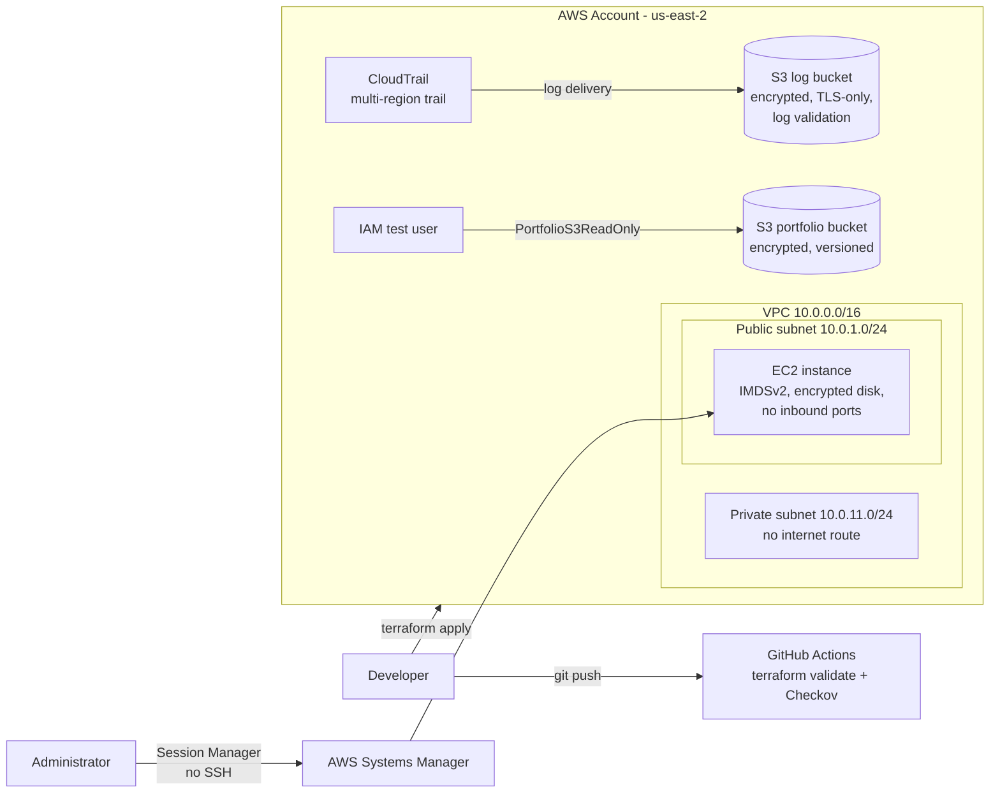
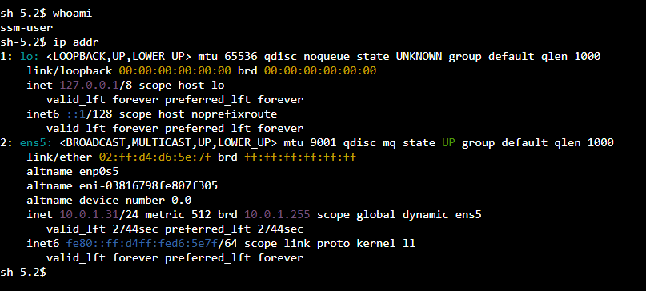
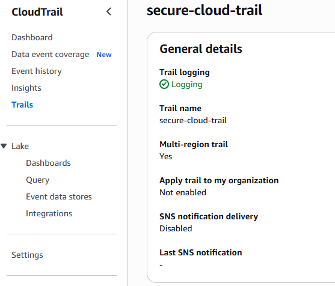
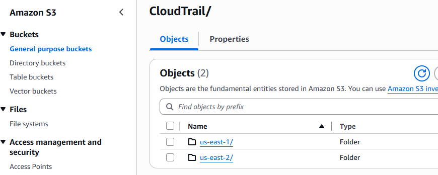

# 🔐 AWS Secure Cloud Infrastructure Automation

## 📌 Project Overview

This project demonstrates AWS cloud security and infrastructure practices using Terraform, AWS IAM, Amazon S3, AWS CloudTrail, Amazon VPC, Amazon EC2, AWS Systems Manager, Python, and Boto3.

The goal is to deploy secure cloud infrastructure entirely through Infrastructure as Code (IaC), implement least-privilege access controls, centralize audit logging, eliminate SSH-based server access, automate IAM security auditing, and scan every change for security issues in a CI/CD pipeline.

## 🛠️ Technologies Used

- **Amazon Web Services (AWS):** Cloud infrastructure
- **Amazon S3:** Secure object storage and audit log storage
- **AWS IAM:** Identity and access management
- **AWS CloudTrail:** Multi-region API activity logging
- **Amazon VPC:** Isolated network with public and private subnets
- **Amazon EC2:** Compute instance with hardened configuration
- **AWS Systems Manager Session Manager:** Shell access without SSH or open ports
- **Terraform:** Infrastructure as Code
- **GitHub Actions and Checkov:** Automated validation and security scanning
- **Python and Boto3:** AWS security auditing automation
- **AWS CLI:** Cloud resource verification
- **Git and GitHub:** Version control and project documentation

## 🏗️ Architecture

- **Cloud Provider:** Amazon Web Services
- **Region:** US East (Ohio) — `us-east-2`
- **Infrastructure:** Terraform-managed S3 buckets, CloudTrail trail, VPC, and EC2 instance
- **Security Focus:** Data protection, least privilege, encryption, audit logging, network isolation, keyless server access, and automated security scanning



## 🔒 Security Controls Implemented

### 1. S3 Public Access Protection

Configured all four Amazon S3 Block Public Access settings on every bucket to help prevent unintended public exposure of stored data.

### 2. Encryption at Rest and in Transit

Enabled default server-side encryption using Amazon S3-managed keys (SSE-S3) with AES-256 encryption. Bucket policies deny any request not made over TLS (`aws:SecureTransport`).

### 3. Bucket Versioning and Lifecycle Management

Enabled S3 versioning to preserve previous object versions and support recovery from accidental changes or deletions. Lifecycle rules expire old CloudTrail logs after 90 days, remove old object versions, and clean up incomplete uploads to control storage costs.

### 4. IAM Least-Privilege Access

Created a test IAM user and attached a custom managed policy named `PortfolioS3ReadOnly`.

The policy grants:

- `s3:ListBucket` access to the designated portfolio bucket.
- `s3:GetObject` access to objects within that bucket.

Permissions are scoped to the specific bucket rather than granting broad S3 access.

### 5. Automated IAM Security Auditing

Developed Python scripts using Boto3 to inspect AWS IAM configuration.

**IAM User Inventory (`list_iam_users.py`)**

- Enumerates IAM users using pagination.
- Reports user creation dates.
- Identifies access keys and their status.
- Flags access keys older than 90 days.
- Retrieves access-key last-used information.
- Lists attached managed policies and their permission documents.
- Identifies inline IAM policies.

**IAM MFA Audit (`audit_iam_mfa.py`)**

- Retrieves the AWS account-level MFA summary.
- Enumerates IAM users using pagination.
- Checks whether MFA devices are assigned to IAM users.

### 6. CloudTrail Audit Logging

Deployed a multi-region CloudTrail trail that records management events, including global services such as IAM and STS, across all AWS Regions.

- **Log file validation** is enabled, so log integrity can be verified with `aws cloudtrail validate-logs`.
- Logs are delivered to a **dedicated S3 bucket** with Block Public Access, encryption, versioning, and bucket-owner-enforced object ownership.
- The bucket policy allows only the CloudTrail service to write, and only for this specific trail (`aws:SourceArn` condition), preventing other trails or accounts from using the bucket.

### 7. Network Isolation with a Custom VPC

Built a VPC with a public subnet and a private subnet that has no route to the internet.

- The VPC's **default security group is locked down** with all rules removed, so nothing can accidentally use it.
- Subnets do not assign public IP addresses by default.

### 8. Keyless Server Access with Session Manager

The EC2 instance has **no SSH key pair and no inbound ports open**. Administrators connect through AWS Systems Manager Session Manager, which authenticates with IAM and logs session activity.

- The security group allows **no inbound traffic** and only HTTPS outbound.
- The instance uses an IAM role with only the `AmazonSSMManagedInstanceCore` managed policy.
- **IMDSv2 is required**, protecting instance credentials from SSRF-style metadata attacks.
- The root volume is **encrypted**.

### 9. CI/CD Security Scanning

Every push runs a GitHub Actions workflow that checks Terraform formatting and validity and scans the configuration with **Checkov**. The pipeline currently passes with zero failed checks. Findings that don't fit this lab are documented as intentional skips with written reasons (see Design Trade-offs below).

## 📸 Screenshots

**Session Manager connection with no SSH or open ports**



**CloudTrail multi-region trail with logging enabled**



**CloudTrail logs delivered to the encrypted S3 bucket**



## ⚖️ Design Trade-offs

This is a personal lab built to keep costs low. Each Checkov finding below was reviewed and skipped deliberately, with the reason recorded in the Terraform code.

| Control | Decision in this lab | Production approach |
|---|---|---|
| EC2 public IP (CKV_AWS_88) | Instance uses a public IP to reach Systems Manager without a NAT gateway. The security group allows no inbound traffic. | Place the instance in the private subnet and reach Systems Manager through VPC interface endpoints. |
| KMS customer-managed keys (CKV_AWS_35, CKV_AWS_145) | SSE-S3 (AES-256) encryption instead of a paid KMS key. | Use a customer-managed KMS key with a restrictive key policy. |
| VPC flow logs (CKV2_AWS_11) | Not enabled, to avoid ongoing cost. | Enable flow logs to S3 or CloudWatch Logs. |
| CloudWatch Logs integration (CKV2_AWS_10) | CloudTrail logs are stored and reviewed in S3. | Stream to CloudWatch Logs with metric filters and alarms. |
| SNS notifications (CKV_AWS_252) | No alerting pipeline in this lab. | Notify a security team topic on log delivery or alarms. |
| S3 access logging (CKV_AWS_18) | Would require an additional bucket. | Send access logs to a central logging bucket. |
| Cross-region replication (CKV_AWS_144) | Would double storage costs. | Replicate audit logs to a second Region. |
| S3 event notifications (CKV2_AWS_62) | No downstream consumer. | Trigger automated processing or alerts. |
| Detailed EC2 monitoring (CKV_AWS_126) | Basic 5-minute metrics are enough. | Enable 1-minute detailed monitoring. |
| Pinned Availability Zones (CKV_AWS_394) | Lab uses a single AZ. | Pin AZ IDs explicitly for multi-AZ deployments. |

## 🧩 Troubleshooting Finding: Service Control Policy

While adding IAM Access Analyzer, `terraform apply` failed with:

```
AccessDeniedException: ... is not authorized to perform: access-analyzer:CreateAnalyzer
... with an explicit deny in a service control policy
```

**Root cause:** This AWS account belongs to an AWS Organization. A **Service Control Policy (SCP)** at the organization level explicitly denies creating Access Analyzers.

**Key takeaway:** SCPs set the maximum permissions for every principal in a member account. An explicit deny in an SCP overrides any IAM allow, even for a role with full account access. Access Analyzer was removed from the configuration, and the rest of the deployment completed successfully.

## 📁 Repository Structure

```
AWS-secure-cloud-infrastructure-automation/
│
├── .github/
│   └── workflows/          # Terraform validation and Checkov scanning
├── scripts/
│   ├── list_iam_users.py
│   └── audit_iam_mfa.py
│
├── screenshots/
│   ├── ssm-session.png
│   ├── cloudtrail-trail.png
│   └── cloudtrail-logs-s3.png
│
├── terraform/
│   ├── main.tf             # Portfolio S3 bucket and bucket policy
│   ├── iam.tf              # Least-privilege IAM user and policy
│   ├── cloudtrail.tf       # CloudTrail trail and log bucket
│   ├── vpc_ec2_ssm.tf      # VPC, subnets, EC2, and Session Manager
│   ├── variables.tf
│   ├── outputs.tf
│   └── .terraform.lock.hcl
│
├── .gitignore
└── README.md
```

## ▶️ Deployment

Prerequisites: Terraform, the AWS CLI with credentials configured, and (optionally) the Session Manager plugin for the AWS CLI.

```bash
cd terraform
terraform init
terraform fmt
terraform validate
terraform plan
terraform apply
```

Connect to the instance without SSH:

```bash
aws ssm start-session --target <instance_id output>
```

Tear everything down when finished:

```bash
terraform destroy
```

## 📊 Audit Findings

The IAM inventory script successfully identified the portfolio test user and reported:

- Zero access keys assigned.
- One attached managed policy: `PortfolioS3ReadOnly`.
- Bucket-scoped S3 list and object-read permissions.
- No inline policies found.

The MFA audit identified that no MFA device was assigned to the test IAM user.

**Audit limitation:** The account-level MFA summary checks root-user MFA status; it does not verify MFA protection for an AWS Builder ID sign-in. These are separate authentication mechanisms.

## ⚠️ Security Considerations

- Terraform state files and local Terraform working directories are excluded from version control.
- AWS credentials and sensitive variable files should never be committed to the repository.
- IAM audit scripts perform read-only inspection and do not modify AWS resources.
- AWS budgets and alerts help monitor spending but do not automatically prevent charges.
- S3 storage, requests, retained object versions, and running EC2 instances may incur costs. Run `terraform destroy` when the lab is not in use.

## 🚀 Future Enhancements

- Move the EC2 instance to the private subnet and reach Systems Manager through VPC interface endpoints.
- Encrypt CloudTrail logs with a customer-managed KMS key.
- Enable VPC flow logs and stream CloudTrail to CloudWatch Logs with alarms for high-risk API calls.
- Add a remote Terraform backend (S3 with state locking).
- Explore additional cloud security services after evaluating costs and account feature availability.

## 💻 Skills Demonstrated

AWS | Amazon S3 | IAM | CloudTrail | VPC | EC2 | Systems Manager | Terraform | Infrastructure as Code | GitHub Actions | Checkov | Python | Boto3 | AWS CLI | Least Privilege | Cloud Security | Encryption | Audit Logging | Network Security | Git | GitHub
