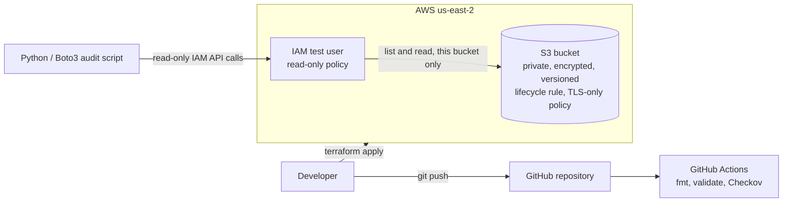

# AWS Secure Cloud Infrastructure Automation


A small AWS security project built with Terraform, Python, and GitHub Actions. It deploys a hardened S3 bucket, manages a least-privilege IAM user as code, audits IAM for common risks, and scans every change with Checkov before it reaches the main branch.

This is a lab project. It shows how I approach secure-by-default infrastructure, and it documents where a production setup would go further.

## 🔍 What it does

- 🪣 **Hardened S3 bucket (Terraform):** public access fully blocked, AES-256 encryption at rest, versioning, a lifecycle rule to control version storage cost, and a bucket policy that denies any request not made over TLS.
- 🔑 **Least-privilege IAM (Terraform):** a test user with one customer-managed, read-only policy scoped to this bucket only (`s3:ListBucket` on the bucket, `s3:GetObject` on its objects). No wildcards, no write access, no console access, no access keys.
- 🐍 **IAM security audit (Python / Boto3):** a read-only script that checks root MFA, access key age and use, console users without MFA, and wildcard permissions in attached and inline policies, then prints a severity summary.
- ✅ **CI pipeline (GitHub Actions):** every push and pull request runs `terraform fmt`, `terraform validate`, and a Checkov security scan. The scan fails the build on any unexplained finding.

## 🏗️ Architecture



## 📁 Repository layout

```
.
├── .github/workflows/terraform-checks.yml   CI: fmt, validate, Checkov
├── terraform/
│   ├── main.tf        S3 bucket, encryption, versioning, lifecycle, TLS policy
│   ├── iam.tf         IAM test user, read-only policy, attachment
│   ├── variables.tf   Region and environment
│   └── outputs.tf
└── scripts/
    └── iam_security_audit.py   IAM audit (read-only)
```

## ▶️ How to run it

Prerequisites: Terraform 1.5 or later, the AWS CLI configured with credentials, and Python 3 with `boto3`.

The S3 bucket name is globally unique, so change it in `terraform/main.tf` before deploying your own copy.

```bash
cd terraform
terraform init
terraform plan
terraform apply

# IAM audit (read-only)
cd ..
pip install boto3
python scripts/iam_security_audit.py

# Tear down to avoid charges
cd terraform
terraform destroy
```

The audit needs read access to IAM. The AWS-managed `SecurityAudit` policy covers it. It makes only List and Get calls.

## 🔐 Security decisions and trade-offs

**✅ Passing checks.** Checkov passes on public access blocking, encryption at rest, versioning, lifecycle configuration, no wildcard IAM actions, no privilege escalation paths, no admin policy attachment, and no console access for the IAM user.

**📝 Documented skips.** Each skip is written next to the resource with a reason:

| Check | Reason skipped | Production approach |
|-------|----------------|---------------------|
| CKV_AWS_144 (cross-region replication) | Would double storage cost for a lab | Replicate to a second region |
| CKV2_AWS_62 (event notifications) | Nothing in this project consumes bucket events | Add notifications for downstream processing |
| CKV_AWS_145 (KMS encryption) | SSE-S3 (AES-256) is sufficient for a lab; a customer-managed key adds cost and key management | SSE-KMS with a customer-managed key and key policy |
| CKV_AWS_18 (access logging) | Needs a dedicated log bucket | Server access logs or CloudTrail data events |
| CKV_AWS_273 (IAM users vs SSO) | Single test user for the audit demo | Use SSO instead of IAM users |
| CKV_AWS_40 (policy attached to user) | One scoped read-only policy on one test user | Attach policies to groups or roles |

**📥 IAM was imported, not rebuilt.** The test user and policy were first created by hand, then brought under Terraform with `terraform import`. The first plan showed a forced replacement because my code was missing the policy's description. I corrected the code and confirmed a clean "No changes" plan before moving on.

## ⚠️ Known limitations

- 🔒 **Root MFA:** the audit reports root MFA as disabled. The IAM credential report shows the root user has no password and no access keys, so root can't be signed in to. Root MFA isn't configurable in this account.
- 🚫 **Console access check:** an organization-level service control policy denies `iam:GetLoginProfile` in this account. The audit script catches the denial, reports the check as skipped, and keeps running instead of failing.
- 🗝️ **Encryption:** the bucket uses SSE-S3, not a customer-managed KMS key (see the table above).
- 📦 **Terraform state** is stored locally. A production setup would use a remote backend (S3 with locking) so state is shared, encrypted, and recoverable.

## 📸 Sample output

(Add a redacted screenshot or text snippet of the audit summary here. Remove account IDs and ARNs.)

## 🚀 Future enhancements

- CloudTrail for API activity logging, with a locked-down log bucket
- IAM Access Analyzer, AWS Config rules, and Security Hub
- Remote Terraform state with locking
- SSE-KMS with a customer-managed key
- A Lambda function that auto-remediates a public bucket
- Scheduled IAM audits with JSON output and alerting

## 💰 Cost

Everything here fits in AWS free credits: S3 storage for an empty or tiny bucket, IAM (free), and no running compute. Run `terraform destroy` when you're done.
